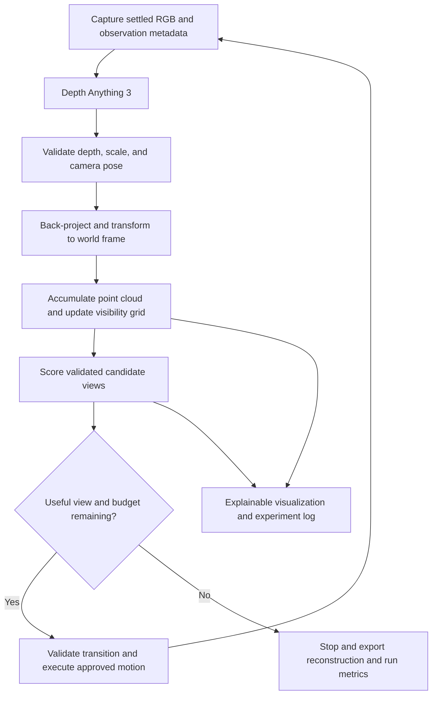

# Occlusion

### Active perception for low-cost robotics

**A robot that decides what it needs to see next.**

Occlusion is an experimental RGB-only perception system for a LeRobot SO-101 with a wrist-mounted camera. It combines learned depth estimation, calibrated geometry, and next-best-view planning to investigate how a low-cost arm can improve its understanding of partially hidden objects through deliberate camera movement.

The intended demonstration is concrete: an object sits behind an obstacle; the robot observes a partial scene, selects a useful reachable viewpoint, moves its camera, and incorporates newly visible surfaces into a shared reconstruction. The interface explains the selected view and measures the resulting improvement.

**Status:** Milestone 1 software is implemented and has passed an offline CPU inference smoke test. Calibration, reconstruction, planning, and robot control are planned. This document defines the complete project; equations and algorithms beyond Milestone 1 describe the intended implementation.

| Project characteristic | Commitment |
| --- | --- |
| Primary sensor | One wrist-mounted USB RGB camera |
| Robot | LeRobot SO-101 follower arm |
| Depth backbone | Depth Anything 3; DA3-Small for initial CPU development |
| Planning | Deterministic selection from a finite set of validated viewpoints |
| Development | Laptop without a GPU; recorded-image replay first |
| Later compute | GPU inference when available; remote processing optional |
| Primary outcome | More reference-surface coverage for a fixed observation budget |
| Physical actuation | Explicit user approval and a validated motion path |

## Contents

- [Research objective and scope](#research-objective-and-scope)
- [System architecture](#system-architecture)
- [Hardware and model strategy](#hardware-and-model-strategy)
- [Mathematical formulation](#mathematical-formulation)
- [Technical execution](#technical-execution)
- [Evaluation protocol](#evaluation-protocol)
- [Milestones and acceptance gates](#milestones-and-acceptance-gates)
- [Installation and current usage](#installation-and-current-usage)
- [Repository organization](#repository-organization)
- [Limitations and open decisions](#limitations-and-open-decisions)
- [References](#references)

## Research objective and scope

> Can a low-cost robotic arm select RGB camera viewpoints that improve the reconstruction of partially occluded tabletop objects, compared with a fixed camera or a predefined sequence of views?

The working hypothesis is that visibility-driven viewpoint selection can recover more useful surface geometry per observation than a fixed acquisition sequence, while keeping movement within a restricted, validated workspace. This is a hypothesis to test; no active-perception performance result is claimed yet.

The contribution is an accessible integration and evaluation of learned geometry and active vision on inexpensive hardware. Active perception and next-best-view planning are established research areas. Occlusion does not claim to introduce a new depth model or the general idea of moving a camera to reduce occlusion.

### Minimum complete demonstration

1. Acquire calibrated RGB observations of a static tabletop scene.
2. Predict depth and establish a defensible spatial scale.
3. Transform accepted observations into a common reference frame.
4. Maintain an accumulated point cloud and a coarse visibility map.
5. Rank a finite set of reachable, approved camera configurations.
6. Execute a validated transition, settle, capture, and update the map.
7. Compare selected views with fixed-view and predefined-view baselines.
8. Display RGB, depth, reconstruction, candidates, chosen view, and measured gain.

Initial scenes contain rigid, stationary, opaque objects under stable lighting. The target region is supplied manually as a bounded tabletop region. The camera mount and focus remain fixed during a run. Calibration may use a printed target of known dimensions; RGB-only refers to runtime sensing, not an absence of geometric priors or calibration measurements.

Grasping, semantic object discovery, TSDF fusion, learned uncertainty models, continuous pose optimization, and remote inference are stretch goals. Policy training, unrestricted exploration, dynamic scene mapping, and general collision avoidance in unknown environments are outside the initial scope.

## System architecture



The perception path must run independently of the robot. Saved observations are the boundary between capture and inference: the laptop can acquire images locally, and those observations can later be processed on larger compute. A remote result may propose geometry; the local controller retains responsibility for freshness checks, pose validation, and motion authorization.

### Observation contract

The planned record contains original RGB, acquisition time, camera identity, image dimensions, calibration identifier, joint state and its timestamp, camera pose and provenance, depth model/revision, processing transform, raw depth, validity mask, scale convention, and inference duration. Every accepted map update must be traceable to its source observation.

Current outputs contain a subset of this contract, described in [Saved outputs](#saved-outputs). Robot poses, calibration records, and synchronized joint timestamps are not collected yet.

## Hardware and model strategy

### Robot and sensing

The SO-101 interface exposes five arm joints and one gripper actuator. The gripper does not supply an independent camera-pose degree of freedom. Consequently, the camera cannot be assumed to realize an arbitrary pose in $SE(3)$. Candidate views will initially be recorded in joint space, with the gripper fixed, and mapped to camera poses by calibrated forward kinematics. See the [LeRobot joint definitions](https://github.com/huggingface/lerobot/blob/main/src/lerobot/robots/so_follower/so_follower.py) and [SO-101 setup documentation](https://huggingface.co/docs/lerobot/so101).

The wrist camera is primary. An optional overhead camera may help with validation or pose estimation, but is not required for the baseline system. LeRobot will provide calibration, joint observations, and motor commands. It is not assumed to provide a calibrated wrist-camera transform or a complete collision-aware motion planner.

### Compute progression

| Stage | Configuration | Purpose |
| --- | --- | --- |
| Local development | CPU, DA3-Small, resolution 252, one observation at a time | Capture, replay, geometry, planner tests |
| Available GPU | Same model and dataset, then resolution 504 | Measure latency, memory, and geometric benefit |
| Larger compute | Evaluate metric or pose-conditioned models | Improve scale and multi-view consistency if justified |

An RTX 2070 Super with 8 GB VRAM and 16 GB host RAM is a potential later target, not a development requirement or verified model budget. CPU-first operation means sequential observation and inference; camera-rate inference is not an acceptance assumption. Record cold model loading separately from warm inference, and include transfer latency in remote experiments.

### Depth Anything 3 checkpoint decision

The initial checkpoint is `depth-anything/DA3-SMALL`, approximately 80M parameters, with an Apache 2.0 model license. It is the smallest published DA3 checkpoint and a practical starting point for CPU experiments, not a guarantee of tabletop accuracy. [Upstream model table](https://github.com/ByteDance-Seed/Depth-Anything-3#️-model-cards)

The current adapter supports this checkpoint only. It uses FP32 on CPU and upstream mixed precision on CUDA. The inspected upstream wrapper enables FP16 autocast on CPU, which the adapter overrides. Source integration is pinned to commit `3d835ec1a5802d64a8b8b15f817a1ab54809bfe4`. [Inspected inference API](https://github.com/ByteDance-Seed/Depth-Anything-3/blob/3d835ec1a5802d64a8b8b15f817a1ab54809bfe4/src/depth_anything_3/api.py)

DA3Metric-Large and the nested metric model are later experiments. Upstream documents focal-length scaling for the metric-only model; the nested model already provides metric output. These require different adapter semantics, memory measurements, and scale validation. Swapping checkpoint names alone is insufficient. Larger checkpoint licenses must also be checked before reuse. [Upstream metric-depth FAQ and model licenses](https://github.com/ByteDance-Seed/Depth-Anything-3#️-model-cards)

## Mathematical formulation

### 1. Active perception as sequential decision-making

At step $t$, RGB observation $I_t$ at camera pose $T_t$ updates scene representation $M_t$. Let $\mathcal{V}_t$ be the finite set of admissible candidate views. The desired decision is

$$
v_t^* = \underset{v\in\mathcal{V}_t}{\arg\max}
\left[\operatorname{IG}(v\mid M_t)-\lambda C(v,q_t)\right],
$$

where $C$ is movement cost from current joint configuration $q_t$. In a fully probabilistic formulation, expected information gain is

$$
\operatorname{IG}(v\mid M_t)
=H(M_t)-\mathbb{E}_{y\sim p(y\mid v,M_t)}
\left[H(M_t\mid y,v)\right].
$$

Here $y$ is a future observation and $H$ is entropy. This motivates the planner; the initial implementation will not claim to compute this posterior or calibrated entropy reduction. It will use the explicit visibility proxy defined below.

### 2. Frames, units, and projection

Use ${}^{A}T_B$ for a rigid transform mapping coordinates from frame $B$ into frame $A$:

$$
{}^A T_B = \begin{bmatrix}R_{AB}&t_{AB}\\0&1\end{bmatrix},
\qquad \bar p_A={}^A T_B\bar p_B.
$$

| Symbol | Convention |
| --- | --- |
| $W$ | Fixed world frame; initially the robot base frame |
| $B$ | Robot base frame |
| $E$ | Defined end-effector mounting frame |
| $C_t$ | Camera optical frame at observation $t$ |
| Camera axes | OpenCV: $+x$ right, $+y$ down, $+z$ forward |
| Geometry units | Meters after scale validation; radians inside kinematics |
| Image coordinates | $u$ is column, $v$ is row; arrays indexed `[v, u]` |

For an undistorted pinhole camera,

$$
K=\begin{bmatrix}f_x&0&c_x\\0&f_y&c_y\\0&0&1\end{bmatrix},
\qquad Z_C\begin{bmatrix}u\\v\\1\end{bmatrix}=Kp_C.
$$

Given optical-axis depth $D_t(u,v)=Z_C$, back-projection is

$$
p_C(u,v)=D_t(u,v)K^{-1}\begin{bmatrix}u\\v\\1\end{bmatrix}.
$$

This assumes axial depth. Euclidean ray range would instead require a normalized ray direction. Mask invalid, nonfinite, nonpositive, out-of-range, and excluded boundary pixels before projection. Calibration and preprocessing must agree with the depth pixel grid. [OpenCV projection and calibration conventions](https://docs.opencv.org/4.x/d9/d0c/group__calib3d.html)

Represent a resize/crop by a pixel-coordinate matrix $A$ and use $K'=AK$. For resize factors $(s_x,s_y)$ followed by crop offsets $(o_x,o_y)$,

$$
A=\begin{bmatrix}s_x&0&-o_x\\0&s_y&-o_y\\0&0&1\end{bmatrix}.
$$

The implementation must match the resampler's pixel-center convention. Undistortion also defines the effective intrinsic matrix. Original-image intrinsics must never be applied unchanged to a resized depth map.

### 3. Recovering and validating metric scale

The initial prediction $\hat D_t$ is relative depth. Independent single-view predictions may differ in scale; intrinsics alone cannot recover meters. A first calibration model is

$$
D_t=s_t\hat D_t,\qquad s_t>0.
$$

This assumes multiplicative scale ambiguity. It is an approximation whose residuals must be checked, not an assertion that one scalar corrects every prediction.

The initial metric anchor will be a stationary board of known dimensions, visible in each accepted observation. Intrinsics and board pose provide metric geometry independently of the depth model. If the board plane in camera coordinates satisfies $n^Tp_C+d=0$, its axial depth at a board pixel is

$$
z_i^{\mathrm{ref}}=\frac{-d}{n^TK^{-1}[u_i,v_i,1]^T}.
$$

Use interior board pixels with positive depth and a well-conditioned denominator. Estimate scale with a robust positive fit:

$$
s_t^*=\underset{s>0}{\arg\min}\;
\sum_{i\in\mathcal{A}_t}w_i\rho(s\hat D_{t,i}-z_i^{\mathrm{ref}}),
$$

where $\mathcal{A}_t$ contains calibration pixels and $\rho$ is a robust loss. Without robust reweighting, weighted least squares gives

$$
s_t^*=\frac{\sum_iw_i\hat D_{t,i}z_i^{\mathrm{ref}}}
{\sum_iw_i\hat D_{t,i}^2}.
$$

Evaluate residuals on held-out board pixels and independent measured geometry at multiple depths. A single plane does not validate shape away from that plane. If the anchor is absent or the fit fails its configured gate, retain the observation for diagnosis and reject its metric map update. Do not silently reuse scale across independent predictions. Exclude the board from target-coverage metrics.

Later alternatives include metric-model inference and scale alignment of a joint multi-view reconstruction to sufficiently varied robot camera translations. Pure rotation or tiny baselines provide poor scale observability. Both alternatives still require independent metric validation.

### 4. Wrist pose and hand–eye calibration

The camera pose used for fusion is

$$
{}^W T_{C_t}={}^W T_B\;{}^B T_E(q_t)\;{}^E T_C.
$$

These terms are a fixed base-to-world transform, forward kinematics from measured joint angles, and a fixed camera mount transform. World points satisfy $\bar p_W={}^W T_{C_t}\bar p_C$.

Convert LeRobot values from their configured units into physical joint angles, with verified offsets, directions, and order. Robot calibration, camera calibration, and camera-to-wrist calibration are separate tasks.

For a stationary observed target, relative robot and camera motions constrain the hand–eye transform $X={}^E T_C$:

$$
A_{ij}X=XB_{ij},
\qquad A_{ij}=({}^B T_{E_i})^{-1}{}^B T_{E_j},
\qquad B_{ij}=({}^W T_{C_i})^{-1}{}^W T_{C_j}.
$$

Camera relative motions can be estimated from target poses in a common fixed target frame; the world frame in this calibration equation need not already be registered to the robot base. Collect varied orientations and translations, assess observability under the arm's kinematic constraints, and validate on held-out poses. Backlash and mount flex remain error sources after calibration.

DA3 extrinsics use world-to-camera convention in a model reference frame. They require inversion and reference-frame/scale alignment before comparison with robot camera poses. They are not robot-base transforms.

### 5. Scene accumulation and geometric consistency

Start with a voxel-downsampled accumulated point cloud:

$$
P_t=\operatorname{VoxelDownsample}_{h}
\left(P_{t-1}\cup\mathcal{P}_t^W\right),
$$

where $h$ is voxel width and $\mathcal{P}_t^W$ contains accepted world-frame points. Preserve observation identifiers and support counts alongside the display cloud. More samples in a voxel do not imply independent evidence or calibrated confidence.

Use overlap to detect inconsistent observations. For a point projected into another accepted view, compare its camera-axis depth $z'$ with observed depth:

$$
e_z=\left|z'-D_j(\pi(K_jp_{C_j}))\right|.
$$

Agreement within a depth-dependent tolerance supports fusion. A point behind the observed surface may be occluded; a point significantly in front is a free-space conflict. Account for image boundaries, missing depth, and pose error before classification. Report rejected updates and residuals.

Registration may later refine poses within bounded corrections. Unconstrained ICP must not silently replace calibration or rescale clouds to improve an evaluation. Thin objects, depth discontinuities, and little overlap can invalidate registration.

### 6. Occlusion and visibility representation

A point cloud cannot distinguish unobserved space from observed empty space. Maintain a separate coarse voxel grid in a fixed region of interest, with **unknown**, **free**, and **occupied** states.

For an accepted depth pixel, the world-space ray is

$$
r(\ell)=c_t+\ell d_t,\qquad\|d_t\|_2=1.
$$

The endpoint distance is $\ell_{\mathrm{hit}}=\|p_W-c_t\|_2$, not generally axial depth $D_t$. Traversed cells before a conservative endpoint margin receive free-space evidence; a narrow endpoint band receives occupied evidence; cells beyond remain unknown. Invalid rays update nothing. Retain conflicts for inspection or reject them under a fixed rule.

Learned depth can hallucinate geometry, so these are operational map labels rather than guaranteed physical occupancy. Repeated support and cross-view agreement will govern promotion of tentative observations. This map alone cannot certify collision-free motion.

Define frontier set $\mathcal F_t$ as unknown cells adjacent to established free space. These mark a boundary of knowledge; they do not assert that a hidden object surface exists there. Restrict the target region so the planner does not spend its budget exploring the room.

### 7. Practical next-best-view score

For each validated candidate, ray-cast a fixed pixel sampling pattern. Stop each ray at established occupied space or its first unknown cell. Count each reached frontier cell once per candidate. This conservative rule avoids treating an arbitrarily long unknown ray as visible.

Let $\mathcal F_t^{\mathrm{vis}}(v)$ contain frontier cells reached through known free space, within the candidate's field of view and configured depth range. Define normalized discovery proxy

$$
G(v)=\frac{\sum_{x\in\mathcal F_t^{\mathrm{vis}}(v)}w_x}
{\max\left(\epsilon,\sum_{x\in\mathcal F_t}w_x\right)}.
$$

Weights initially equal one inside the target region and zero outside it. Segmentation and learned uncertainty are unnecessary for the first version. This estimates an opportunity to observe unknown space; it is not true surface coverage, predicted hidden geometry, or entropy.

For the five arm joints, use normalized movement cost

$$
C(v,q_t)=\sum_{j=1}^{5}\alpha_j
\frac{|q_j(v)-q_{t,j}|}{q_j^{\max}-q_j^{\min}},
\qquad\alpha_j\geq0,\quad\sum_j\alpha_j=1.
$$

For transitions containing intermediate waypoints, replace each endpoint difference by accumulated absolute joint travel along that path. Use permitted intervals; do not assume wrapping an angle produces an executable shorter path. Select

$$
v_t^*=\underset{v\in\mathcal V_t^{\mathrm{safe}}}{\arg\max}
\left[G(v)-\lambda C(v,q_t)\right].
$$

Safety and reachability define the admissible set before scoring. They are hard constraints, not penalties information gain can outweigh. Initially, candidates are recorded joint configurations reachable from the current state through validated transitions. Exclude revisits in the first pass; break ties by stable candidate identifier.

Set $\lambda$ on development scenes and freeze it before evaluation. Log predicted gain and realized reconstruction change after every accepted observation to assess the proxy itself.

### 8. Stopping conditions

Stop when the observation, movement, or elapsed-time budget is exhausted; no admissible candidate remains; the best discovery score falls below a configured threshold; or repeated accepted observations yield negligible map change. Calibration failure, stale pose, motion fault, or operator stop also halts the loop.

A small frontier score means the planner has exhausted its current map and candidate set. It does not prove the whole object has been observed. Ground-truth coverage is an evaluation metric unavailable to the runtime planner.

## Technical execution

### Calibration and reconstruction sequence

1. Fix camera mount, focus, resolution, and exposure policy. Calibrate intrinsics and distortion with a known board across the working field of view.
2. Validate joint conventions and forward kinematics. Collect diverse board observations for hand–eye calibration; assess held-out pose errors.
3. At a stationary pose, pair a fresh frame with measured joint state. Store timestamp skew and reject captures during motion or before settling. Camera buffering must not pair an old image with a new pose.
4. Estimate depth and metric scale. Gate updates on calibration visibility, scale residuals, valid-depth fraction, and consistency checks.
5. Back-project, transform, crop, and downsample. Inspect single-view clouds before multi-view accumulation.
6. Fuse predefined views and validate overlap before autonomous choice. Add the visibility grid after this geometry path is credible.

Determine thresholds from measured camera and arm errors. Choose voxel size and consistency tolerances accordingly; a sharper grid cannot compensate for inaccurate poses. Freeze and publish parameters used in comparative experiments.

### Candidate views and motion execution

Begin with a small, manually commissioned set of observation configurations and a graph of validated transitions. Each configuration stores angles, derived camera pose, permitted transitions, and calibration identity. A safe endpoint does not imply a safe interpolated path.

Validate joint limits, increments and velocity, swept arm and camera-mount volume, self-collision, table and obstacle clearance, and cable travel. Use conservative scene bounds and physical inspection during commissioning. Changed obstacles invalidate affected transitions. Unknown volume is not automatically safe for the arm to enter.

Physical movement requires explicit user approval. An approved run must specify its commissioned configurations, transitions, bounds, and speed limits. The planner may select within that envelope and cannot expand it. Keep an accessible hardware stop or power cutoff, reject stale commands, and stop on unexpected state deviation or timeout. Ctrl-C alone is not a complete physical stop mechanism. Establish stop behavior during commissioning; removing torque may be unsafe under gravity.

No physical movement is implemented or authorized by the current software.

### Planned loop

```text
load calibration, target bounds, candidate graph, and experiment budget
validate configuration; require approval before enabling physical motion
capture at initial commissioned configuration
while budget remains:
    verify frame freshness, joint synchronization, and calibration identity
    estimate depth; establish scale; reject invalid map updates
    transform accepted points; update reconstruction and visibility
    score admissible unvisited candidates; log score components
    if no useful candidate remains: stop
    validate transition within the approved motion envelope
    execute slowly; monitor state; settle; capture a fresh observation
export observations, calibration, decisions, timings, and reconstruction
```

### Demo interface

Show RGB, depth visualization, the world-frame cloud, target bounds, frontiers, camera history, candidate views, and selected transition. A score panel reports discovery gain and movement cost separately. Before/after reconstruction highlights newly supported geometry.

Label frontier gain and view counts as exploration indicators. Display reference-based coverage only in offline evaluation or a clearly identified reference-assisted demo. A heuristic percentage must not appear as verified object completeness.

## Evaluation protocol

### Baselines and controlled acquisition

| Method | View selection | Purpose |
| --- | --- | --- |
| Fixed view | Initial observation only | Establish single-view visibility |
| Predefined sequence | Fixed order of commissioned views | Measure benefit of additional observations |
| Active NBV | Visibility score and movement cost | Measure benefit of choosing observations |
| Random sequence, optional | Seeded admissible choices | Check against arbitrary exploration |

Use the same initial view, target region, candidate set, calibration, model, resolution, and reconstruction parameters. Compare active and predefined methods at equal observation budgets; report movement and time separately. Also compare at matched movement or time budgets where practical. Replay a common static view dataset for controlled comparisons, then validate policies in separate physical runs. Replay timing is not physical closed-loop timing.

Vary obstacle height, occlusion severity, and object shape. Separate development scenes from held-out evaluation scenes. Repeat physical acquisition to capture pose/depth variability. Report paired per-scene results, aggregate spread, failed runs, and stop reasons. An all-candidate reconstruction may provide a reachable-view reference, but is not independent ground truth.

### Reference-surface coverage and accuracy

Let $S_{\mathrm{ref}}$ be a uniformly surface-sampled independent target reference and $P_t$ the reconstructed target cloud in the same metric frame. Define $d(x,P)=\min_{p\in P}\|x-p\|_2$ and coverage at tolerance $\tau$:

$$
\operatorname{Coverage}_{\tau}(P_t)=\frac{1}{|S_{\mathrm{ref}}|}
\sum_{x\in S_{\mathrm{ref}}}\mathbf{1}[d(x,P_t)<\tau].
$$

Also report reconstruction precision:

$$
\operatorname{Precision}_{\tau}(P_t)=\frac{1}{|P_t|}
\sum_{p\in P_t}\mathbf{1}[d(p,S_{\mathrm{ref}})<\tau].
$$

Coverage alone can reward thick or hallucinated geometry. Precision and surface-distance errors expose that failure. Sample/downsample consistently, isolate the target from the table, obstacle, and board, and report tolerance in meters. Reference geometry may come from known CAD or an independent dense scan; document its uncertainty.

Fix reference registration independently of each method. Do not fit per-method scale or use unrestricted alignment against test geometry. Declare whether coverage includes inaccessible undersides or a fixed accessible subset; keep the denominator unchanged across methods and runs.

### Reported measures

| Measure | Definition or reporting rule |
| --- | --- |
| Surface coverage | Reference recall at stated distance tolerance |
| Accuracy | Reference precision; median and 95th-percentile surface distance |
| Observation efficiency | Coverage versus accepted observations; include rejected capture counts |
| Motion | Per-joint absolute travel in radians and normalized planner cost |
| Time | Capture, transfer, inference, fusion, planning, motion, settling, and total wall time |
| Resources | Peak host resident memory and allocated CUDA memory where applicable |
| Calibration | Reprojection error, held-out pose residuals, metric scale residuals |
| Planner quality | Predicted gain versus realized reference-coverage increment |
| Reliability | Completion rate, rejected updates, faults, and stop reason |

Success means higher held-out coverage than the fixed view and a favorable coverage-versus-observation tradeoff against the predefined sequence, without degrading precision beyond a declared tolerance. Report movement/time even if they offset the coverage benefit. No improvement percentage is promised before collecting results.

Useful ablations include movement penalty on/off, calibrated scale versus raw relative depth in offline diagnosis, and single-view versus joint multi-view inference when supported. Relative-depth fusion is not a valid metric control input; it is only a diagnostic comparison.

## Milestones and acceptance gates

| Milestone | Deliverable | Gate before advancing | Status |
| --- | --- | --- | --- |
| 1. RGB and depth | Capture, image inference, preview, numeric outputs | Verify camera and laptop latency/memory on tabletop scenes | Software implemented; offline CPU smoke test passed |
| 2. Calibrated geometry | Intrinsics, distortion, metric anchor, single-view cloud | Held-out calibration/scale residuals acceptable for declared voxel size | Planned |
| 3. Known viewpoints | LeRobot adapter, hand–eye calibration, commissioned transition graph | Approved slow transitions and synchronized known-pose observations | Planned |
| 4. Multi-view fusion | Shared-frame cloud and consistency rejection | Stable overlap and independently measured accuracy | Planned |
| 5. Active selection | Visibility grid, scoring, finite candidate planner, stopping | Useful replay choices; physical runs stay within approved envelope | Planned |
| 6. Evaluation and demo | Baselines, logs, explainable visualization | Reproducible metrics and declared limitations | Planned |

Planned synthetic tests cover known-pose back-projection, transform composition/inversion, resized intrinsics, scale-fit outliers, visible versus occluded rays, duplicate frontier counting, deterministic ties, exhausted candidates, and inadmissible transitions. Hardware tests remain separate and require explicit motion approval.

## Installation and current usage

These commands run Milestone 1. Planned mapping, calibration, planner, and controller commands do not exist yet.

### CPU setup on Linux

Use Python **3.11**; this project also declares 3.12 support. The laptop's system Python 3.14 is outside the inspected DA3 dependency range. From the project root, with [uv](https://docs.astral.sh/uv/) installed:

```bash
uv python install 3.11
uv venv --python 3.11
source .venv/bin/activate
export HF_HOME="$PWD/data/models"
uv pip install -e '.[dev]'
uv pip install torch torchvision --index-url https://download.pytorch.org/whl/cpu
uv pip install -r requirements-inference.txt
git clone https://github.com/ByteDance-Seed/Depth-Anything-3.git vendor/Depth-Anything-3
git -C vendor/Depth-Anything-3 checkout 3d835ec1a5802d64a8b8b15f817a1ab54809bfe4
uv pip install --no-deps -e vendor/Depth-Anything-3
```

Skip cloning if that checkout exists. The deliberate `--no-deps` installation uses `requirements-inference.txt` for the imports needed by this integration, including eager export imports. It avoids the full upstream GPU-oriented dependency set. [Inspected upstream package metadata](https://github.com/ByteDance-Seed/Depth-Anything-3/blob/3d835ec1a5802d64a8b8b15f817a1ab54809bfe4/pyproject.toml)

Keep `HF_HOME` set in later shells to reuse the project-local cache. First inference downloads DA3-Small weights, approximately 320 MB of FP32 parameters plus cache overhead. For GPU experiments, use a separate environment with compatible PyTorch/torchvision CUDA wheels; CPU wheels do not enable CUDA.

### Capture and infer

For live RGB preview, use `--preview --capture-only`. Press Space or `s` to save
the current frame and `q`/Escape to quit. Preview does not save continuously:

```bash
# Logitech overhead camera
occlusion --camera /dev/video0 --preview --capture-only --output data/overhead
# Innomaker wrist camera
occlusion --camera /dev/video2 --preview --capture-only --output data/wrist
```

Omit `--capture-only` for a continuously updated RGB/depth preview:

```bash
occlusion --camera /dev/video0 --preview --output data/overhead-depth
```

Depth preview updates sequentially at inference speed; RGB-only preview avoids
loading the model. Space/`s` saves the displayed RGB/depth observation together.
`--preview` requires a display and replaces the snapshot/`--frames` workflow.
Device numbers may change on reconnect; persistent `/dev/v4l/by-id/` paths can
also be passed to `--camera`.

RGB capture requires only the base package, without Torch or DA3:

```bash
uv pip install -e .
occlusion --camera 0 --capture-only
```

Infer from a saved image, locally or after copying it to another machine:

```bash
occlusion --image data/captures/<capture>/rgb.png --no-display
```

Capture, infer, display, and save one observation, or repeat sequentially:

```bash
occlusion --camera /dev/video0
occlusion --camera 0 --frames 0
```

Defaults are CPU, resolution 252, and one observation. Resolution must be a multiple of 14 and at least 28. `--frames 0` repeats until stopped. Press `q`/Escape when the window is responsive or Ctrl-C in the terminal; inference blocks display handling between results. The final snapshot waits for a key. Use `--no-display` on headless hosts. Every processed frame is saved, so continuous runs consume disk space. Camera permissions must allow device access.

On Linux Wayland sessions with XWayland available (`DISPLAY` is set), the CLI defaults Qt to its bundled `xcb` backend unless `QT_QPA_PLATFORM` is already set. To override a shell setting that requests the unavailable Wayland plugin:

```bash
QT_QPA_PLATFORM=xcb occlusion --camera /dev/video2 --output data/depth-test
```

This requires a running XWayland display. If unavailable, use `--no-display`; images and numeric depth are still saved. The Qt backend can be selected through [`QT_QPA_PLATFORM`](https://doc.qt.io/qt-6/qpa.html#selecting-a-qpa-plugin).

### Saved outputs

Each inference creates a unique directory under `data/captures/`:

| File | Meaning |
| --- | --- |
| `rgb.png` | Original captured RGB, lossless PNG |
| `rgb_processed.png` | Processed RGB aligned with depth |
| `depth.npy` | Raw float32 relative depth, loaded with `numpy.load` |
| `prediction.npz` | Available confidence, predicted intrinsics and extrinsics |
| `preview.png` | RGB beside percentile-normalized depth, for display |
| `metadata.json` | Source, model, device, resolution, dimensions, scale/frame conventions, inference time, process peak RSS, optional CUDA allocation |

Capture-only saves `rgb.png`. Intrinsics/extrinsics are model predictions, not calibration. No robot-base pose or metric depth is recorded. Preview colors normalize independently per observation; use numeric depth for experiments.

### Verification to date

```bash
pytest
```

Eight hardware-independent tests pass: RGB channel preservation, lossless depth storage, invalid/constant depth display, camera-failure cleanup, capture without model loading, and live RGB/depth preview with saving only on keypress.

The pinned DA3 source and CPU PyTorch processed upstream's `assets/examples/SOH/000.png`, saved numeric outputs, and produced a visually inspected preview. Offline cached inference also succeeded. Initial warm inference was approximately 0.11–0.19 seconds in the execution environment at resolution 252. This is a smoke test, not a laptop, tabletop, or accuracy benchmark.

USB RGB capture from both cameras and wrist/overhead CPU depth inference have
since been exercised. On the saved object scene, resolution 504 made the robot
silhouette clearer than 252, while the phone and remote remained challenging.
This is a qualitative comparison, not validated geometric accuracy. Shared
captures, quality reports, and a replay command are in [data/README.md](data/README.md).
GUI behavior still needs confirmation on each desktop. CUDA, metric scale,
reconstruction, and active robot perception remain unverified. There are no NBV
results yet.

## Repository organization

Current files:

```text
.
├── README.md
├── pyproject.toml
├── requirements-inference.txt
├── src/occlusion/
│   ├── __init__.py
│   ├── camera.py          # USB acquisition and RGB loading
│   ├── depth.py           # DA3-Small CPU/CUDA adapter
│   ├── outputs.py         # Numeric outputs, metadata, previews
│   └── main.py            # Milestone 1 CLI
└── tests/
    └── test_pipeline.py
```

Planned modules are added when their milestones require them:

| Module or directory | Responsibility |
| --- | --- |
| `calibration.py` | Intrinsics, distortion, hand–eye records, validation |
| `geometry.py` | Back-projection, transforms, scale alignment |
| `reconstruction.py` | Accepted cloud fusion and consistency checks |
| `visibility.py` | Ray traversal, free/occupied/unknown state, frontiers |
| `nbv.py` | Scoring, movement cost, deterministic selection |
| `robot.py` | Isolated LeRobot connection, observations, approved motion |
| `evaluation.py` | Reference metrics and baseline comparisons |
| `configs/` | Versioned calibration, bounds, candidates, experiment parameters |
| `scripts/` | Capture, replay, calibration, evaluation entry points |

Selected small camera datasets and reports under `data/` are versioned for
teammate replay; model caches, upstream sample outputs, and new experiment
directories remain ignored by default. `vendor/` and the virtual environment are
also ignored. Keep original observations immutable and identify calibration/model
revisions in derived artifacts. Avoid services, training infrastructure, and
complex storage until a demonstrated need warrants them.

## Limitations and open decisions

| Issue | Initial response | Evidence required |
| --- | --- | --- |
| Relative scale | Per-observation metric board anchor | Held-out residuals and measured distances |
| Close-range depth | Tabletop captures and boundary masking | Errors on small objects/thin surfaces |
| Wrist pose | Kinematic and hand–eye calibration | Held-out pose and overlap residuals |
| Backlash/mount flex | Settled captures, conservative tolerances | Repeatability across approach directions |
| Visibility approximation | Target-restricted frontier proxy | Predicted versus realized gain |
| Restricted kinematics | Recorded configurations/transition graph | Commissioned reachable views |
| Transparent/reflective objects | Excluded from first success claim; later stress tests | Separately reported failures |
| Compute budget | CPU replay, later GPU benchmark | Latency and peak memory |
| Reference geometry | Independent reference or explicitly labeled proxy | Fixed reference and coverage denominator |

Calibration tolerances, board placement, candidate count, voxel width, depth range, and score weights remain commissioning decisions. Record them before comparative evaluation. Next: real-camera tabletop capture and a measured CPU baseline, followed by calibrated single-view geometry.

## References

1. Lin et al. **Depth Anything 3: Recovering the Visual Space from Any Views.** 2025. Learned geometry backbone. [Paper](https://arxiv.org/abs/2511.10647) · [Code and models](https://github.com/ByteDance-Seed/Depth-Anything-3).
2. Morrison, Corke, and Leitner. **Multi-View Picking: Next-Best-View Reaching for Improved Grasping in Clutter.** ICRA, 2019. Context for viewpoint selection and fixed-view comparisons. [Publication](https://research.monash.edu/en/publications/multi-view-picking-next-best-view-reaching-for-improved-grasping-/).
3. Arruda, Wyatt, and Kopicki. **Active Vision for Dexterous Grasping of Novel Objects.** IROS, 2016; arXiv, 2017. Context for wrist-camera sensing tied to reconstruction and action. [Paper](https://arxiv.org/abs/1708.04185).
4. Wang et al. **GraspView: Active Perception Scoring and Best-View Optimization for Robotic Grasping in Cluttered Environments.** 2025. Context for RGB-only reconstruction, scoring, and metric alignment. [Paper](https://arxiv.org/abs/2511.04199).
5. Hugging Face. **LeRobot and SO-101 documentation.** Robot setup and integration. [Repository](https://github.com/huggingface/lerobot) · [SO-101](https://huggingface.co/docs/lerobot/so101).
6. OpenCV. **Camera Calibration and 3D Reconstruction.** Projection, pose estimation, and hand–eye conventions. [Documentation](https://docs.opencv.org/4.x/d9/d0c/group__calib3d.html).

Depth Anything 3 was publicly released in November 2025, making it the project's recent technology component. Hackathon eligibility depends on the event's actual date and rules; older active-vision references establish research context. [Upstream release announcement](https://github.com/ByteDance-Seed/Depth-Anything-3#-news)
